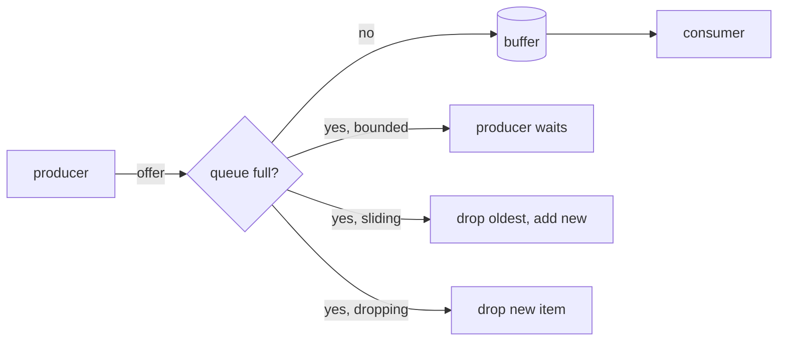

# 02 · Backpressure, explained from zero

> Run the demo while you read: `pnpm lesson 23`

## 1. The problem: a fast producer and a slow consumer

A restaurant kitchen. The **cook** puts a plate on the counter every 6 seconds (10 per minute).
The **waiter** carries a plate to a table every 30 seconds (2 per minute).

```
  cook  ──10 plates/min──▶  [ counter ]  ──2 plates/min──▶  waiter
                              ▲
                              every minute, 8 more plates pile up here
```

Where do the extra 8 plates per minute go? Something has to give. In software:

- **producer** = anything that creates work: a loop, an HTTP request handler, a socket, a file reader
- **consumer** = the thing that handles the work: a worker, a database write, a browser on a slow phone
- **counter** = the buffer in between: an array, a queue, a socket buffer

**Backpressure** is the consumer pushing back on the producer: *"slow down, I'm full"*.
The word comes from plumbing: when a pipe is narrower downstream, pressure builds up and pushes back
toward the source. More loosely, people also use the word for the whole topic: *"what's our
backpressure strategy?"* means *"what happens when the buffer is full?"*

## 2. What breaks when you ignore it

The regular way: an array as the counter (lesson 20's `regularWay`, lesson 23's `regularWay`).

```ts
const counter: number[] = []
setInterval(() => counter.push(makePlate()), 50)   // nobody ever says "stop"
```

1. **Memory grows until the process crashes.** An unbounded buffer is only bounded by RAM.
2. **Latency grows.** Plate #1000 waits behind 999 others. Everything is "accepted", but served minutes late.
3. **Data is lost anyway.** When the process crashes (OOM), every plate on the counter goes with it.

So "never drop anything" via an unbounded buffer is an illusion. You have to decide.

## 3. The 4 strategies

Give the counter a **size**. Then pick what happens when it is full.

| # | Strategy | When full... | Effect API | Lost data? | Good for |
|---|----------|--------------|------------|------------|----------|
| 1 | **Backpressure (wait)** | the producer **waits** until there is room | `Queue.bounded(n)`, a pull-based `Stream` | none | jobs, payments, file processing: every item matters |
| 2 | **Bounded buffer** | absorbs short bursts, then waits (strategy 1) | `Stream.buffer({ capacity })` | none | smoothing a bursty source |
| 3 | **Sliding** | accept the new item, **drop the oldest** | `Queue.sliding(n)`, `Stream.buffer({ capacity, strategy: "sliding" })` | old items | "latest price", cursor position, progress bar |
| 4 | **Dropping** | keep what's there, **drop the new item** | `Queue.dropping(n)`, `Stream.buffer({ capacity, strategy: "dropping" })` | new items | metrics sampling, "a sample is enough" |

What lesson 23 prints (cook every 50ms, waiter every 200ms, counter size 2, 8 plates):

```
bounded   cook offered 3  size=2  WAITED 99ms     -> served [1,2,3,4,5,6,7,8]  lost 0
sliding   cook never waits                        -> served [3,7,8]            lost 5  (kept the newest)
dropping  cook never waits                        -> served [1,2,5]            lost 5  (kept the oldest)
```

Notice: with `bounded`, the cook was **slowed down to the waiter's pace**. That is backpressure.
The total time went up (1.9s instead of ~0.4s for the cook), but nothing was lost and memory stayed at 2 plates.



## 4. Pull-based means backpressure for free

There are two ways to move data:

- **Push**: the producer calls you whenever it wants (`EventEmitter`, `setInterval`, `EventSource.onmessage`).
  The producer sets the pace. You have to buffer whatever arrives.
- **Pull**: the consumer asks *"give me the next one"* when it's ready. The consumer sets the pace.

An Effect `Stream` is **pull-based**: nothing runs until the downstream asks for the next element.
So a slow consumer automatically slows the producer, with no buffer at all:

```ts
Stream.paginate(1, (page) => fetchPage(page))   // fetch page N+1 only when page N is used up
  .pipe(Stream.take(4))                          // 4 items = 2 pages; pages 3..100 are never fetched
```

Lesson 23's "bonus" section prints `fetching page 1`, `fetching page 2`, and stops. Lesson 15 uses the same idea.

## 5. Where push breaks it

Push sources don't know how to wait. When we bridge them into a Stream, a buffer appears again:

- **`Stream.callback` + `Queue.offerUnsafe`** (our `EventSource` bridge in
  `src/features/todos/client/todosAtoms.ts`): the browser fires `onmessage` whenever the server sends.
  `offerUnsafe` cannot wait (it's a plain callback), so if the consumer falls behind the buffer fills,
  and the buffer strategy you pass to `Stream.callback` (`bufferSize`, `strategy`) decides what is dropped.
- **PubSub subscribers** (lesson 20, `src/features/todos/jobs/todoJobs.ts`): every subscriber has its own
  buffer. A slow subscriber either slows down the publisher (bounded PubSub: one slow listener slows
  everyone), or loses messages (sliding/dropping PubSub). Pick deliberately.

Rule of thumb: **at every push → pull boundary, write down the buffer size and the strategy.**

## 6. Across the network

Backpressure works across machines too, mostly without you noticing:

- **TCP flow control.** The receiver tells the sender how much space its receive buffer has ("window").
  When the receiver's app stops reading, the window shrinks to 0 and the sender's kernel stops sending.
- **`ReadableStream`** (what a Next.js route returns for streaming). Its queue has a **high water mark**;
  `controller.desiredSize` = high water mark − what is queued. When the browser reads slowly, `desiredSize`
  drops to 0 or below and `pull()` is not called again. A stream built with `pull()` (which is what
  `Stream.toReadableStreamEffect` in our routes does) therefore only produces when there is room.

The whole chain, in the SSE routes (`src/app/api/v2/events/route.ts`):

```
Effect Stream ─pull─▶ ReadableStream ─▶ TCP socket ─▶ slow phone
        ▲                 desiredSize≤0      window=0      reads slowly
        └──────────── each step waits for the next one ◀──────────┘
```

A slow browser slows the server's stream, instead of the server buffering megabytes for it.

## 7. How to choose

| Question | Choose |
|----------|--------|
| Is every item important (orders, jobs, emails)? | **bounded** queue (wait) |
| Is the source bursty but the average rate fine? | **bounded buffer** (`Stream.buffer`) sized for a burst |
| Do I only care about the latest value? | **sliding** |
| Is a sample good enough, and the oldest data is fine? | **dropping** |
| Can the producer simply be pulled instead? | Use a pull-based `Stream`; no buffer needed |
| Is the producer a push source I can't slow (webhooks, browser events)? | sliding/dropping, or persist to a DB/queue first |

**Never choose** an unbounded buffer for input you don't control.

## Where this repo uses it

- `src/lessons/advanced/23-backpressure.ts`: all 4 strategies side by side, with timings
- `src/lessons/advanced/20-queue-pubsub-schedule.ts`: `Queue.bounded(2)` making the producer wait
- `src/lessons/advanced/15-streams.ts`: pull-based streams
- `src/features/todos/jobs/todoJobs.ts`: a bounded job queue shared by workers
- `src/features/todos/client/todosAtoms.ts`: `Stream.callback` bridging `EventSource` (a push source)

## Self-check quiz

1. The waiter is faster than the cook. Which of the 4 strategies loses data? <details><summary>Answer</summary>None. The buffer never fills, so the strategy never kicks in.</details>
2. You stream a live stock price to a dashboard. Bounded, sliding, or dropping? <details><summary>Answer</summary>Sliding: an old price is worthless once a newer one exists.</details>
3. Why doesn't `Stream.paginate(...).pipe(Stream.take(4))` fetch all 100 pages? <details><summary>Answer</summary>Streams are pull-based: the next page is only requested when the consumer asks for more, and `take(4)` stops asking.</details>
4. Why is an unbounded queue not "safe because it never drops"? <details><summary>Answer</summary>Memory and latency grow without limit, and on an out-of-memory crash everything in it is lost.</details>
5. With `Queue.bounded`, what is the cost of "nothing lost"? <details><summary>Answer</summary>The producer is slowed down to the consumer's pace (the WAITED lines in lesson 23).</details>
