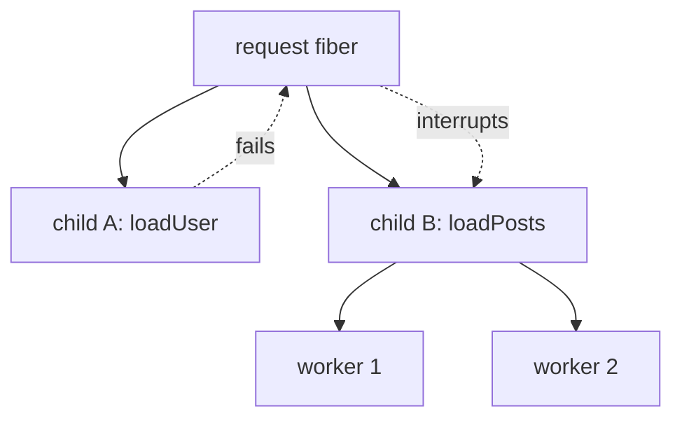

# 03 · Concurrency foundations: event loop, fibers, structured concurrency, Scope

> Read this before lessons [11](../../src/lessons/intermediate/11-concurrency.ts),
> [12](../../src/lessons/advanced/12-semaphores-and-fibers.ts) and
> [13](../../src/lessons/advanced/13-resources-scope.ts).

## 1. The JS event loop in 5 minutes

JavaScript runs your code on **one thread**. Think of a single cook in a kitchen with a ticket rail.

```
            ┌──────────────── call stack (the cook) ────────────────┐
            │ runs ONE piece of code at a time, to completion        │
            └───────────────────────────▲────────────────────────────┘
                                        │ when the stack is empty:
         1. drain ALL microtasks  ──────┤   (Promise .then, await continuations)
         2. then take ONE task    ──────┘   (setTimeout, I/O callback, incoming request)
```

- A **task** (macrotask) is a ticket on the rail: a timer firing, a socket having data.
- A **microtask** is "finish this right after the current step": every `await` continuation is one.
- `await` does **not** make anything parallel. It means "pause me, let the cook do something else,
  put my continuation back on the rail when the value is ready".

```ts
await fetchA() // ~100ms
await fetchB() // ~100ms   -> ~200ms total: sequential
await Promise.all([fetchA(), fetchB()]) // ~100ms: both requests are in flight together
```

The last version is faster not because JS got a second thread, but because both network requests wait
**at the same time** while the single thread is free. That is **concurrency**.

## 2. Concurrency vs parallelism

| | Concurrency | Parallelism |
|---|---|---|
| Meaning | many tasks *in progress* at once, interleaved | many tasks *executing* at the same instant |
| Kitchen | one cook juggling 5 pans | 5 cooks |
| In JS | the default (event loop) | only with worker threads / separate processes |

Effect fibers give you **concurrency** on one thread. That is exactly what I/O-heavy servers need:
most time is spent waiting on the DB or HTTP, not computing.

### Bounded vs unbounded

`Promise.all(items.map(fetch))` on 10 000 items starts 10 000 requests at once: unbounded. You
hammer the API, exhaust sockets or the DB pool, and get rate limited.

```ts
Effect.forEach(items, fetchOne, { concurrency: 5 })           // bounded: at most 5 in flight
Effect.forEach(items, fetchOne, { concurrency: "unbounded" }) // only for small, fixed, trusted sets
```

Rule of thumb: if the number of items comes from users or a database, **always bound it**
(lesson 11). If the limit belongs to a *shared resource* used across the program, use a
`Semaphore` (lesson 12).

## 3. What is a fiber?

A **fiber** is a lightweight, interruptible, cooperatively scheduled unit of Effect work.

- **Lightweight**: it is just an object in memory; you can have hundreds of thousands.
- **Cooperatively scheduled**: the Effect runtime runs a fiber for a while, then yields back to the
  event loop so other fibers (and the rest of JS) get a turn. No OS threads involved.
- **Interruptible**: anyone holding the fiber handle can say "stop", and the fiber stops at the next
  safe point, running its finalizers.

### Fiber vs Promise

| | Promise | Fiber |
|---|---|---|
| Starts | immediately, when created (eager) | when you run/fork the Effect (an Effect is a lazy description) |
| Cancel | impossible; you can only ignore the result | `Fiber.interrupt(fiber)` really stops it |
| Cleanup on cancel | none | finalizers / `acquireRelease` releases run |
| Knows its parent | no | yes, it lives in a fiber tree |
| Result | value or rejection (`unknown`) | `Exit<A, E>`: success, typed failure, defect, or interruption |

A Promise is a *receipt* for work that is already happening. A fiber is a *worker you can recall*.

## 4. Structured concurrency: the fiber tree

In Effect, a child fiber lives **inside** its parent. When the parent ends, its remaining children
are interrupted, so nothing keeps running unattended.

```
                    request fiber (root, from runPromise)
                    ┌─────────┴──────────┐
          Effect.all child A        Effect.all child B
              │                          │
         forEach worker 1..5        race: left / right
```



Consequences:

- `Effect.all([a, b])`: if `a` fails, `b` is interrupted (Promise.all keeps `b` running).
- `Effect.race(a, b)`: the loser is interrupted (Promise.race lets it run to completion).
- Nothing leaks: there is no "fire and forget" by accident. Background work must be *explicitly*
  attached to some lifetime (see Scope below).

## 5. Interruption

Interruption is a **message that travels down the tree**:

```
interrupt(root)
   └─▶ interrupt children (deepest first) ─▶ each runs its finalizers ─▶ root runs its finalizers ─▶ Exit = interrupted
```

### From Next.js to Effect: `AbortSignal`

When a browser closes a tab or a `fetch` is aborted, Next exposes that as `request.signal`. We pass
it to the runtime, which turns "signal aborted" into "interrupt the root fiber":

```ts
// src/app/api/v2/events/route.ts
runtime.runPromise(program, { signal: req.signal })
```

So a disconnected client stops the in-flight DB queries and HTTP calls instead of letting them
finish for nobody. See also `src/app/api/effect/profile/[id]/route.ts` and
`src/app/api/effect/events-stream/route.ts`.

### Uninterruptible regions

Some steps must not be cut in half (e.g. "charge card + write receipt"). Mark them:

```ts
Effect.uninterruptible(chargeAndRecord) // an interrupt waits until this finishes

Effect.uninterruptibleMask((restore) =>
  Effect.gen(function* () {
    const lock = yield* acquire
    yield* restore(doLongWork) // only this part CAN be interrupted
    yield* release(lock)
  }))
```

`Effect.acquireRelease` already makes the *acquire* step uninterruptible for you, which is why you
rarely need these directly.

## 6. Scope: a lifetime

A **Scope** is a lifetime with a list of cleanups attached. When the scope closes (success,
failure, or interruption), every finalizer runs in reverse order (lesson 13).

```
Scope opened ─▶ acquire DB pool ─▶ acquire cache ─▶ fork sweeper fiber ─▶ ... ─▶ Scope closed
                                                                        ◀── stop sweeper
                                                                        ◀── close cache
                                                                        ◀── close DB pool
```

### Which fork?

| Function | Fiber lives as long as... | Use for |
|---|---|---|
| `Effect.forkChild` | the **parent fiber** | short background work inside one operation; `Fiber.join` it later |
| `Effect.forkScoped` | the surrounding **Scope** (e.g. a Layer) | long-running loops that belong to a service |
| `Effect.forkIn(scope)` | a **specific** scope you pass | attaching to a lifetime other than the current one |
| `Effect.forkDetach` | **nothing** (global, until it ends itself) | almost never; the "fire and forget" escape hatch |

### Why the todos jobs use `forkScoped`

`src/features/todos/jobs/todoJobs.ts` starts its queue workers and schedulers with
`Effect.forkScoped` inside a Layer. The Layer's scope is the app runtime's lifetime:

- the fibers outlive whatever fiber happened to build the layer (a `forkChild` would die with it);
- but they still stop when `runtime.dispose()` runs (test end, hot reload, shutdown), which a
  `forkDetach` would never do, leaving zombie loops that keep writing to the DB.

## Where this repo uses it

- Concurrency limits and races: `src/lessons/intermediate/11-concurrency.ts`
- Fibers and semaphores: `src/lessons/advanced/12-semaphores-and-fibers.ts`
- Scope, `acquireRelease`, `forkScoped`: `src/lessons/advanced/13-resources-scope.ts`
- Background jobs: `src/features/todos/jobs/todoJobs.ts`
- `AbortSignal` to interruption: `src/app/api/v2/events/route.ts`, `src/app/api/effect/profile/[id]/route.ts`

## Self-check quiz

1. Does `await a(); await b();` run `a` and `b` at the same time? Why not?
2. Name two things a fiber can do that a Promise cannot.
3. In `Effect.all([a, b])`, `a` fails after 10ms and `b` takes 1s. What happens to `b`?
4. A client closes the tab mid-request. What turns that into an Effect interruption?
5. You need a poller that runs as long as a service exists. `forkChild`, `forkScoped` or `forkDetach`?
6. Why is `concurrency: "unbounded"` dangerous for a list loaded from the database?

<details><summary>Answers</summary>

1. No. They run one after another; `await` only frees the thread while waiting.
2. Be really stopped (interrupted), run cleanup on interruption, belong to a parent (no leaks), report a typed `Exit`.
3. It is interrupted right after `a` fails, and its finalizers run.
4. Passing `{ signal: req.signal }` to `runtime.runPromise`.
5. `forkScoped`, inside the service's Layer.
6. The list size is unknown and can be huge, so you could open thousands of connections or requests at once.

</details>
