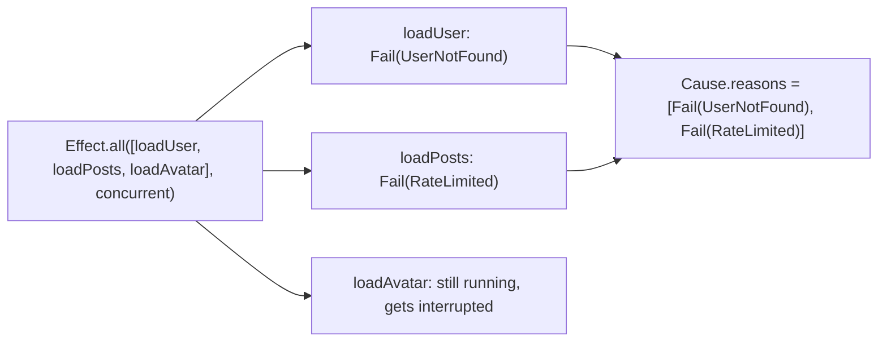
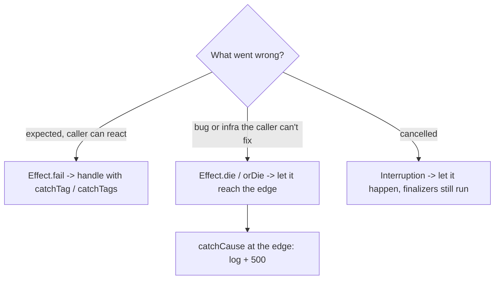

# 04. Errors and Cause: failure vs defect vs interruption

> Run the lesson alongside this page: `pnpm lesson 25` (`src/lessons/advanced/25-errors-and-cause.ts`).

## The problem with `try/catch`

```ts
try {
  await Promise.all([loadUser("1"), loadPosts("1")])
} catch (e) {
  // e: unknown
}
```

Three things go wrong here:

1. `e` is `unknown`. "User not found" (expected, return a 404) and "cannot read property of undefined" (a bug) look exactly the same.
2. `Promise.all` keeps only the **first** rejection. If both calls failed, the second error is gone.
3. A cancelled request (`AbortError`) is just one more thing that gets thrown.

Effect separates these cases and keeps every error.

## Three ways an Effect can end

Think of a delivery driver. There are three ways the delivery can go wrong:

| Outcome | Analogy | In Effect | In the type? |
|---|---|---|---|
| **Failure** | "Nobody home." Expected, and there's a plan for it. | `Effect.fail(new UserNotFound(...))` | Yes, in `E` |
| **Defect** | "The van's engine exploded." A bug. Nobody planned for it. | `Effect.die(...)`, or a thrown exception inside `Effect.sync` | No |
| **Interruption** | "Dispatch called: cancel the run." Nothing failed, someone stopped us. | `Effect.interrupt`, timeouts, a losing `race`, a fiber being cancelled | No |

`Effect<A, E, R>` only lists **failures** in `E`. Defects and interruptions can happen to any effect, so putting them in the type tells you nothing.

## Exit and Cause

Every effect that finishes ends in exactly one `Exit`:

```
Exit<A, E>
├── Success(value: A)
└── Failure(cause: Cause<E>)
        └── reasons: [ Fail(E) | Die(defect) | Interrupt(fiberId), ... ]
```

A `Cause` is a **list of reasons**. Usually there's one. When several things go wrong, all of them are kept:



Here's what the lesson prints for that (stack lines trimmed):

```
Cause.pretty(cause):
  UserNotFound:
  RateLimited:

Walking through it, reason by reason:
  [0] Fail      error={"_tag":"UserNotFound","id":"1"}
  [1] Fail      error={"_tag":"RateLimited","retryAfterMs":500}
hasFails=true hasDies=false hasInterrupts=false
```

How to read a printed Cause:

- Each block in `Cause.pretty` is **one reason**. The first line is the error's name and message, then its stack trace.
- A `Fail` shows your error class (`UserNotFound`). A `Die` shows the defect (often `Error: ...`). An interruption mentions the fiber that was interrupted.
- Use `cause.reasons` with `Cause.isFailReason`, `Cause.isDieReason` and `Cause.isInterruptReason` to inspect it in code, or the shortcuts `Cause.hasFails`, `Cause.hasDies`, `Cause.hasInterrupts`, `Cause.findError`, `Cause.findDefect`.
- The slow sibling that `Effect.all` stopped does **not** show up as an `Interrupt`. Stopping it was cleanup done by `Effect.all`, not a reason the whole thing failed.

In the lesson the two failing calls are marked `Effect.uninterruptible`, like an HTTP request that's already in flight. Without that, the first failure interrupts the second before it fails, and you'd see just one `Fail`.

You get the Exit as a plain value with `Effect.exit(effect)`. It never fails, so it's handy in tests and lessons.

## `orDie` or keep it typed? Ask: "can the caller do anything about it?"

- **Yes** -> keep it typed. `UserNotFound` turns into a 404, `RateLimited` into a retry. The caller needs to see it in `E`.
- **No** -> make it a defect. A lost DB connection inside a repository: the HTTP handler can't fix it. Putting `SqlError` in every signature only forces every caller to write `catch` blocks that rethrow it.

```ts
// Every error becomes a defect:
repo.list.pipe(Effect.orDie)

// Only one tag becomes a defect, the rest stay typed:
findUser(id).pipe(Effect.catchTag("DbDown", (e) => Effect.die(e)))
```

**Where this repo uses it:** [`src/features/todos/infrastructure/todoRepositorySql.ts`](../../src/features/todos/infrastructure/todoRepositorySql.ts) has `orDieOnInfra`. It turns SQL/infra errors into defects **in the adapter**, and leaves domain errors like "todo not found" typed. The decision is made once, at the edge of the infrastructure, not in every caller. Lesson 19 (`src/lessons/advanced/19-sql.ts`) explains the same rule.

## The handler toolbox

| Tool | Sees | Removes from `E` | Use it for |
|---|---|---|---|
| `Effect.catchTag("X", f)` | one tagged failure | `X` | Handling a single expected case |
| `Effect.catchTags({ X: f, Y: g })` | several tagged failures | the handled tags | Mapping domain errors to responses (404, 429...) |
| `Effect.catch(f)` | every typed failure | all of `E` | Fallback values, "any failure -> default" |
| `Effect.catchCause(f)` | the whole `Cause`: fails, defects, interrupts | all of `E` | The edge of the app: log everything, render a 500 page |
| `Effect.sandbox` | moves the `Cause` into `E` | `E` becomes `Cause<E>` | Using normal combinators (`catch`, `mapError`, `retry`) on the full Cause. |
| `Effect.catchDefect(f)` | only defects | nothing | Rare: plugin boundaries, third-party code you don't trust |

Important: `catch`, `catchTag` and `catchTags` **do not see defects**. That's on purpose: a bug shouldn't be swallowed by a handler that was written for "user not found". The lesson shows `catch` on a defect: it still dies.



## DON'T

- Don't use `catchCause` everywhere "to be safe". You'll swallow bugs and break interruption.
- Don't put infra errors (`SqlError`, `HttpClientError`) in domain service signatures when no caller can do anything about them.
- Don't `throw` inside `Effect.gen`. Use `yield* Effect.fail(...)` for expected errors. A thrown exception becomes a defect.

## Self-check quiz

1. `Effect.sync(() => JSON.parse("{"))` throws. Does the error show up in `E`? What kind of reason is it?
2. Two effects run with `Effect.all(..., { concurrency: "unbounded" })` and both fail (neither gets interrupted first). How many reasons does the Cause have?
3. Your repository can fail with `TodoNotFound` and `ConnectionLost`. Which one should stay typed, and why?
4. You wrote `effect.pipe(Effect.catch(() => Effect.succeed(0)))`, but the program still crashed. What kind of reason must the Cause have contained?
5. When would you reach for `sandbox` instead of `catchCause`?

<details>
<summary>Answers</summary>

1. No. It's a `Die` (defect). Use `Effect.try` if you want a typed failure instead.
2. Two `Fail` reasons. Nothing is lost.
3. `TodoNotFound` stays typed (the caller can return a 404). `ConnectionLost` becomes a defect (`orDie`), because no caller can fix it.
4. A `Die` (or an `Interrupt`). `catch` only handles typed failures.
5. When you want normal error combinators (`catch`, `mapError`, `retry`, `tapError`) to work on the whole Cause. (Effect v4 has no `unsandbox`: handle the Cause, or re-raise it with `Effect.failCause`.)

</details>
